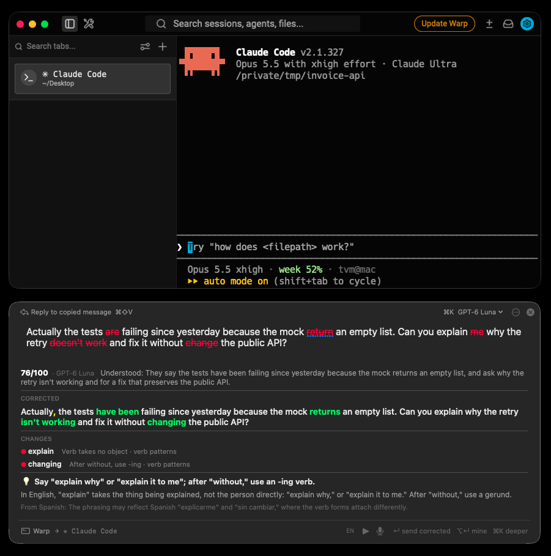
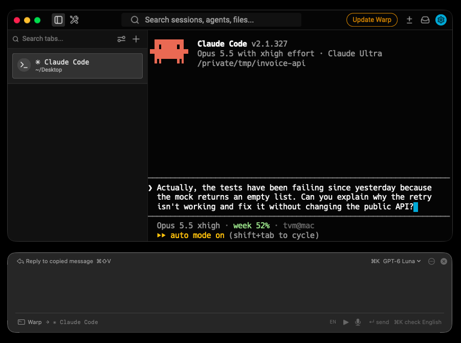
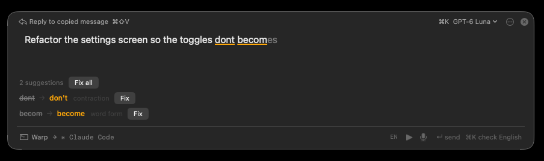
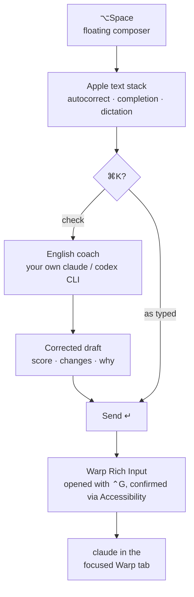

<div align="center">


# TypeFlow

**Native macOS text intelligence for the prompts you write to AI agents.**

[](#requirements)
[](Package.swift)
[](LICENSE)
[](#roadmap)

Autocorrect · inline completion · grammar · dictation — right where you talk to Claude Code.

[Features](#features) · [Install](#install) · [Usage](#usage) · [How it works](#how-it-works) · [Roadmap](#roadmap) · [Why this exists](#why-this-exists) · [Privacy](#privacy)



<sub>⌘K on a prompt before it goes to Claude Code: a score, the corrected version, and why.</sub>

</div>

---

Terminal emulators don't use `NSTextView`, so they bypass Apple's entire writing stack. TypeFlow is a small floating composer that gives you the full Apple text experience, then hands your prompt to **Warp's Rich Input** editor — which pastes and submits it into the focused `claude` session natively. No copy/paste. No clipboard hijack (the pasteboard is saved and restored).

> [!NOTE]
> **v0.1** — works end-to-end on macOS 26 (Tahoe). Claude Code + Warp only for now. [Roadmap below](#roadmap).

## Features

- **Apple text intelligence in the composer** — autocorrect, continuous spellcheck, grammar, text replacement, Writing Tools. Smart quotes/dashes are **off** on purpose so `"strings"` and `--flags` in your prompts aren't mangled.
- **Contraction autocorrect** — fixed as you type, on a word boundary, in any draft language: `dont`, `doesnt`, `didnt`, `isnt`, `wasnt`, `arent`, `werent`, `havent`, `hasnt`, `couldnt`, `wouldnt`, `shouldnt`, `im`, `ive` (plus a lone `i` → `I`). `cant`, `wont`, `ill`, `id`, `its`, `were`, `well`, `hell` and `shell` are real words, so they're never auto-fixed: the right form depends on the sentence, and the spell checker and the suggestions panel can still point them out.
- **Sentence starts capitalized** — `give me` → `Give me`, `done. it works` → `done. It works`, and `i'm` / `i've` / `i'll` / `i'd` → `I'm`…, once the word is typed. Only a plain lowercase word, so `--force`, `readme.md` or `iOS` stay as typed; not after `e.g.`, `etc.`, `...` or `:`; ⌘Z undoes it.
- **Apple dictation** — a mic button (or your system dictation shortcut) dictates straight into the composer.
- **Straight into Claude Code** — ↵ hands the prompt to Warp's Rich Input in the focused tab, which submits it to `claude`. Nothing is pasted until Warp confirms Rich Input opened. If it doesn't open, nothing is typed anywhere: the composer keeps the text and shows **"Couldn't open Warp's input — text kept"** with a **Copy** button.
- **Keep-open mode** (default on) — Enter sends but leaves the composer open for rapid multi-send.
- **Multi-session aware** — the composer **follows the focused Warp tab** and keeps a **separate draft per `claude` session**, so switching tabs never loses what you typed.



<p align="center"><sub>The composer under Warp: ↵ put the prompt into the focused <code>claude</code> session.</sub></p>

- **Inline word completion** — finishes the word you're typing (`becom` → `become`) as gray ghost text via the system dictionary: instant, local, English or Spanish detected per draft. **Tab** accepts.
- **On-device suggestions** — while you pause on an English draft, Apple's on-device model (Foundation Models) lists grammar and word-form fixes under the text, each with **Fix** (or **Fix all**). Nothing is applied until you click. Fixes land on whole words only, and a plural noun isn't made singular unless the sentence calls for it.



<p align="center"><sub>Inline completion in gray, and the on-device suggestions panel under the draft.</sub></p>

- **⌘K English coach** — checks the draft before you send: a score, grammar and usage fixes with a one-click corrected version (tracked as editable colored changes), and why each mistake happened, including when it comes from Spanish. It also catches single-word Spanish false friends used with their Spanish meaning (actually = actualmente, eventually = eventualmente, assist = asistir, …). Runs through **your own** `codex`, `claude` or `agy` CLI; which model runs it by default was [measured](docs/coach-benchmark.md). Optional — everything else works without it.
- **Reply mode** — attach the message you're answering (⌘⇧V or **Reply to copied message**; a copied screenshot works too), write your own idea in English or Spanish, and ⌘K suggests a reply that answers what was asked, the way it was asked.

### Beyond Claude Code

Select text in any app (or copy it, where the app won't share its selection, like Warp), then:

- **Right-click → Correct with TypeFlow** or **Translate with TypeFlow**, in apps that support macOS Services.
- **⌥⌘E** — correct it in the composer with the ⌘K check; ↵ copies the result. By default the selection is cut first, so ⌘V puts the correction in its place (a ⋯ setting).
- **⌥⌘K** — quick fix: only the corrected text, pasted over the selection.
- **⌥⌘T** — translate English ↔ Spanish in a small card under the selection, with ▶ and **Copy**.
- **⌥⌘R** — read it aloud in a small player.

The shortcuts cover apps without Services, like Warp and most Electron apps. Translation (Apple's Translation framework) and the voices run on-device: free, and offline once English and Spanish are downloaded (System Settings → General → Language & Region → Translation Languages).

## Requirements

- **macOS 26 (Tahoe) or newer.** The build links Apple's `FoundationModels` framework (the on-device model behind the suggestions), which pins the deployment target to macOS 26.
- [Warp](https://warp.dev), with `claude` running in at least one tab.
- **Accessibility permission** (required) — to send keystrokes into Warp's Rich Input, read which tab is focused, and read a selection in another app. Granted on first launch.
- **Microphone permission** (optional) — only if you use dictation.
- Swift toolchain from current Xcode / Command Line Tools.

## Install

The proper way — a real, signed `/Applications` app you can Spotlight-search and auto-launch:

```bash
git clone https://github.com/michael-v17/typeflow.git
cd typeflow

# 1. one-time: a stable self-signed code-signing identity, so macOS keeps your
#    Accessibility/Microphone grants across rebuilds (click "Always Allow" on
#    the first build's codesign prompt)
./scripts/make-cert.sh

# 2. build the icon, then the signed .app: make-app.sh installs it to
#    /Applications and opens it (--no-install builds only the local bundle)
./scripts/make-icon.sh
./scripts/make-app.sh release
```

On first launch, grant **Accessibility** (System Settings → Privacy & Security → Accessibility → TypeFlow), and **Microphone** the first time you dictate. To launch automatically, add `/Applications/TypeFlow.app` to **System Settings → General → Login Items**.

**Dev mode** (quick iteration, no bundle): `swift run TypeFlow` — note that as a bare binary it won't have dictation or persistent permissions; use the `.app` for real use. `swift test` runs the unit tests.

## Usage

| Action | Shortcut |
|---|---|
| Open / close composer | **⌥Space** |
| Send prompt to `claude` (the coach's version, if one is showing) | **↵** (Enter) |
| Send as typed | **⌥↵** |
| New line | **⇧↵** (Shift + Enter) |
| Accept inline suggestion | **⇥** (Tab) |
| Check English / suggest a reply | **⌘K** |
| Reply to the copied message | **⌘⇧V** |
| Copy instead of sending | **⌘⇧C** |
| Read aloud | **⌥⌘S** |
| Switch between sending to Warp and copying | **⌘T** |
| Close the panel, then the composer | **⎋** (Escape) |
| Dictate | the **🎙** button (or your system dictation shortcut) |

The footer shows where ↵ goes (Warp → the focused tab), the draft's language, read aloud, the mic, and the main keys. The **⋯** menu holds the settings (Keep open after sending, Show on all desktops, Send to Warp, Tag sends for the learning log, …) and the full shortcut list. Sending always targets Warp's **frontmost** tab — switch sessions by clicking the Warp tab and the composer follows it. The shortcuts that work in any app are under [Beyond Claude Code](#beyond-claude-code).

## How it works



Your pasteboard is saved and restored around each send, nothing is pasted until Warp confirms Rich Input opened, and the composer follows the focused Warp tab by matching its window title (`WarpInspector`) to a detected `claude` session (`ProcessWatcher`).

<details>
<summary>Source layout</summary>

| Source | Responsibility |
|---|---|
| `App.swift` | Lifecycle, ⌥Space hotkey, menu bar, launch-time Accessibility prompt |
| `ComposerWindow.swift` | The floating composer: footer, ⋯ menu, keyboard handling, suggestions and coach panels, Warp tab-follow + per-session drafts |
| `GhostTextView.swift` | Draws the gray inline suggestion (kept out of the text buffer) |
| `WordCompleter.swift` | Current-word completion via `NSSpellChecker` |
| `GrammarReviewer.swift` | The on-device suggestions (Foundation Models): grammar and word-form fixes, never auto-applied |
| `ContractionCorrector.swift` | The unambiguous apostrophe fixes (`dont`→`don't`) + `i`→`I`, and sentence starts / `i'm` capitalized |
| `DraftLanguage.swift` | English or Spanish per draft; Spanish pauses the English-only helpers |
| `EnglishCoach.swift` | The ⌘K coach and reply mode: bundled prompts and schemas, run through `codex`, `claude` or `agy` |
| `TrackChanges.swift` | Word diff from your draft to the coach's version (removed in red, added in green, slips in yellow) |
| `CoachInsights.swift` | Local, model-free notes for the coach panel from the learning log (inert unless configured) |
| `WingmanEnglishLog.swift` | One send's record and its optional tag; appends ⌘K-checked sends to the learning log (inert unless configured) |
| `ScreenText.swift` | Reply mode: a pasted screenshot, read on-device by Apple Vision |
| `SelectedText.swift` | Text selected in another app: right-click → TypeFlow (macOS Services) and the ⌥⌘E / ⌥⌘K / ⌥⌘T hotkeys |
| `SelectionCard.swift` | The small card under a selection: a translation or a quick correction |
| `Translator.swift` | English ↔ Spanish with Apple's on-device Translation framework |
| `Speaker.swift` | Read aloud with Apple's on-device voices |
| `ReadAloudPanel.swift` | ⌥⌘R's player |
| `GhostCompleter.swift` | **Dormant** — on-device Foundation Models phrase completion |
| `WarpInjector.swift` | The send path — keystroke synthesis into Warp's Rich Input |
| `RichInputCheck.swift` | Confirms ⌃G opened Rich Input before anything is pasted |
| `WarpInspector.swift` | Reads Warp's focused-window title for session-following |
| `ProcessWatcher.swift` | `libproc` detection of `claude` sessions (adaptive polling) |
| `HotKey.swift` | Carbon hotkeys (⌥Space and the any-app shortcut table), and the double-tapped ⌥ ⌥ |
| `PTYWriter.swift` | **Legacy** — the old PTY-write path, not used |

Build helpers in `scripts/`: `make-cert.sh` (stable signing identity, once), `make-icon.sh` (renders `Resources/AppIcon.icns`), `make-app.sh` (build + bundle + sign). Unit tests in `Tests/TypeFlowTests`: send tags, contractions, suggestion placement, the coach files, the send failure, `TrackChanges`, `WordCompleter`, the any-app shortcuts, the right-click services, translation and read aloud.

</details>

## Roadmap

> [!IMPORTANT]
> **Status — v0.1.** Works end-to-end: composing with Apple text intelligence, word completion, contraction autocorrect, dictation, per-session drafts with live Warp-tab following, submission into Warp's Rich Input. Packaged as a signed, installable, login-launchable app. Known limits:

- [ ] Picker-driven tab switching (the dropdown swaps the draft but doesn't switch the Warp tab yet — AX traversal is the next step)
- [ ] A send while a plain shell tab is in front isn't caught: ⌃G gives the same signal there as over `claude`, so the prompt would be pasted into the shell
- [ ] Foundation Models phrase mode (wired, dormant — word completion is the active engine)
- [ ] Beyond Warp: other agents/terminals (Warp's Rich Input is the integration point — see [warp#8579](https://github.com/warpdotdev/Warp/issues/8579))
- [ ] Proper distribution (currently self-signed; fine for personal use)

## Why this exists

If you spend hours a day writing prose-heavy prompts to Claude Code, doing it in a terminal that bypasses Apple autocorrect is friction you stop noticing but never stop paying. Safari, Notes, Mail, the ChatGPT app — all give you the full Apple writing stack. Your terminal, where you do the most language-dense work of your day, gives you nothing. TypeFlow gives that stack back, scoped to the moments you're talking to an AI agent.

## Privacy

TypeFlow makes **no network calls of its own and collects nothing**. The only thing that leaves the composer is the prompt you send, delivered as keystrokes into your own Warp. The ⌘K coach runs your own `codex`, `claude` or `agy` CLI with your logins — TypeFlow ships no API keys and talks to no endpoints. A screenshot pasted for reply mode goes to that same CLI for the check, and is never saved beyond it or logged. Translation and read aloud use Apple's on-device frameworks. To read a selection in another app, the any-app shortcuts use Accessibility, or a ⌘C that puts your clipboard back afterwards.

An optional local learning-log integration (for an English-practice corpus) is compiled in but stays **completely inert** unless it's explicitly configured on your machine (the `WingmanEnglishConfig` default or `$WINGMAN_ENGLISH_VAULT`). Its companion setting, **Tag sends for the learning log** (⋯ menu, **off by default**), starts each prompt sent to Warp with a short tag the learning-log hook reads: `;;tf ` sent as written, `;;tf+ ` the coach's version, `;;re ` a reply, `;;v ` dictated. Off, the text reaches Warp exactly as written. Copies (⌘⇧C) never carry a tag.

## License

[MIT](LICENSE) © 2026 michael-v17
