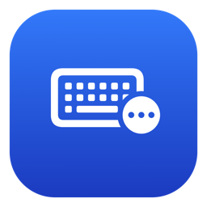

<div align="center">



# TypeFlow

**Native macOS text intelligence for the prompts you write to AI agents.**

[](#requirements)
[](Package.swift)
[](LICENSE)
[](#status)

Autocorrect · inline completion · grammar · dictation — right where you talk to Claude Code.

[Features](#features) · [Install](#install) · [Usage](#usage) · [How it works](#how-it-works) · [Roadmap](#roadmap) · [Why this exists](#why-this-exists)

<!-- HERO-SCREENSHOT: composer floating over a Warp window, mid-suggestion — assets/hero.png -->

</div>

---

Terminal emulators don't use `NSTextView`, so they bypass Apple's entire writing stack. TypeFlow is a small floating composer that gives you the full Apple text experience, then hands your prompt to **Warp's Rich Input** editor — which pastes and submits it into the focused `claude` session natively. No copy/paste. No clipboard hijack (the pasteboard is saved and restored).

> [!NOTE]
> **v0.1** — works end-to-end on macOS 26 (Tahoe). Claude Code + Warp only for now. [Roadmap below](#roadmap).

## Features

- **Apple text intelligence in the composer** — autocorrect, continuous spellcheck, grammar, text replacement, Writing Tools. Smart quotes/dashes are **off** on purpose so `"strings"` and `--flags` in your prompts aren't mangled.
- **Inline word completion** — finishes the word you're typing (`becom` → `become`) as gray ghost text via the system dictionary: instant, local, English + Spanish auto-detected. **Tab** accepts.
- **Contraction autocorrect** — `dont` → `don't`, `im` → `I'm`, lone `i` → `I`, on word boundary. A small curated map, so code tokens aren't touched.
- **Sentence starts capitalized** — `give me` → `Give me`, `done. it works` → `done. It works`, and `i'm` / `i've` / `i'll` / `i'd` → `I'm`…, once the word is typed. Only a plain lowercase word, so `--force`, `readme.md` or `iOS` stay as typed; not after `e.g.`, `etc.`, `...` or `:`; ⌘Z undoes it.
- **⌘K English coach** — checks the draft before you send: grammar and usage feedback with a one-click corrected version (tracked as editable colored changes), run through **your own** `claude` / `codex` CLI. Optional — everything else works without it.
- **Apple dictation** — a mic button (or your system dictation shortcut) dictates straight into the composer.
- **Keep-open mode** (default on) — Enter sends but leaves the composer open for rapid multi-send.
- **Multi-session aware** — the composer **follows the focused Warp tab** and keeps a **separate draft per `claude` session**, so switching tabs never loses what you typed.

## Requirements

- **macOS 26 (Tahoe) or newer.** The build links Apple's `FoundationModels` framework (for a dormant on-device phrase-completion mode), which pins the deployment target to macOS 26.
- [Warp](https://warp.dev), with `claude` running in at least one tab.
- **Accessibility permission** (required) — to send keystrokes into Warp's Rich Input and read which tab is focused. Granted on first launch.
- **Microphone permission** (optional) — only if you use dictation.
- Swift toolchain from current Xcode / Command Line Tools.

## Install

The proper way — a real, signed `/Applications` app you can Spotlight-search and auto-launch:

```bash
git clone https://github.com/michael-v17/typeflow.git
cd typeflow

# 1. one-time: a stable self-signed code-signing identity, so macOS keeps your
#    Accessibility/Microphone grants across rebuilds (click "Always Allow" on
#    the first build's codesign prompt)
./scripts/make-cert.sh

# 2. build the icon + the signed .app, then install it
./scripts/make-icon.sh
./scripts/make-app.sh release
cp -R TypeFlow.app /Applications/
open /Applications/TypeFlow.app
```

On first launch, grant **Accessibility** (System Settings → Privacy & Security → Accessibility → TypeFlow), and **Microphone** the first time you dictate. To launch automatically, add `/Applications/TypeFlow.app` to **System Settings → General → Login Items**.

**Dev mode** (quick iteration, no bundle): `swift run TypeFlow` — note that as a bare binary it won't have dictation or persistent permissions; use the `.app` for real use.

## Usage

| Action | Shortcut |
|---|---|
| Open / close composer | **⌥Space** |
| Send prompt to `claude` | **↵** (Enter) |
| New line | **⇧↵** (Shift + Enter) |
| Accept inline suggestion | **⇥** (Tab) |
| Dismiss suggestion / close composer | **⎋** (Escape) |
| Dictate | the **🎙** button (or your system dictation shortcut) |

The footer shows the targeted session (e.g. `claude · TypeFlow`), the **keep open** toggle, the mic button, and the hotkey hints. Sending always targets Warp's **frontmost** tab — switch sessions by clicking the Warp tab and the composer follows it.

## How it works

```
⌥Space → compose with Apple text intelligence → ↵
                       │
                       ▼
          WarpInjector (needs Accessibility):
            activate Warp
            ⌃G  open Rich Input
            ⌘V  paste the prompt
            ↵   submit  → claude
            pasteboard restored
```

The composer follows the focused Warp tab by reading its window title via the Accessibility API (`WarpInspector`) and matching it to a detected `claude` session (`ProcessWatcher`).

| Source | Responsibility |
|---|---|
| `App.swift` | Lifecycle, ⌥Space hotkey, menu bar, launch-time Accessibility prompt |
| `ComposerWindow.swift` | The floating composer, footer, keyboard handling, Warp tab-follow + per-session drafts |
| `GhostTextView.swift` | Draws the gray inline suggestion (kept out of the text buffer) |
| `WordCompleter.swift` | Current-word completion via `NSSpellChecker` |
| `ContractionCorrector.swift` | Apostrophe fixes (`dont`→`don't`) + `i`→`I`, and sentence starts / `i'm` capitalized |
| `GhostCompleter.swift` | **Dormant** — on-device Foundation Models phrase completion |
| `WarpInjector.swift` | The send path — keystroke synthesis into Warp's Rich Input |
| `WarpInspector.swift` | Reads Warp's focused-window title for session-following |
| `ProcessWatcher.swift` | `libproc` detection of `claude` sessions (adaptive polling) |
| `HotKey.swift` | Carbon ⌥Space registration |
| `PTYWriter.swift` | **Legacy** — the old PTY-write path, not used |

Build helpers in `scripts/`: `make-cert.sh` (stable signing identity, once), `make-icon.sh` (renders `Resources/AppIcon.icns`), `make-app.sh` (build + bundle + sign).

## Roadmap

> [!IMPORTANT]
> **Status — v0.1.** Works end-to-end: composing with Apple text intelligence, word completion, contraction autocorrect, dictation, per-session drafts with live Warp-tab following, submission into Warp's Rich Input. Packaged as a signed, installable, login-launchable app. Known limits:

- [ ] Picker-driven tab switching (the dropdown swaps the draft but doesn't switch the Warp tab yet — AX traversal is the next step)
- [ ] Foundation Models phrase mode (wired, dormant — word completion is the active engine)
- [ ] Beyond Warp: other agents/terminals (Warp's Rich Input is the integration point — see [warp#8579](https://github.com/warpdotdev/Warp/issues/8579))
- [ ] Proper distribution (currently self-signed; fine for personal use)

## Why this exists

If you spend hours a day writing prose-heavy prompts to Claude Code, doing it in a terminal that bypasses Apple autocorrect is friction you stop noticing but never stop paying. Safari, Notes, Mail, the ChatGPT app — all give you the full Apple writing stack. Your terminal, where you do the most language-dense work of your day, gives you nothing. TypeFlow gives that stack back, scoped to the moments you're talking to an AI agent.

## Privacy

TypeFlow makes **no network calls of its own and collects nothing**. The only thing that leaves the composer is the prompt you send, delivered as keystrokes into your own Warp. The ⌘K coach runs your own `claude`/`codex` CLI with your logins — TypeFlow ships no API keys and talks to no endpoints. An optional local learning-log integration (for an English-practice corpus) is compiled in but stays **completely inert** unless its vault path is explicitly configured on your machine.

## License

[MIT](LICENSE) © 2026 michael-v17
